# Архітектура викликів, щоб простежити шлях від сторінки до моделі

Цей файл для того, хто змінює сторінку або API і має побачити, який сервіс і яка модель бази зачепляться. Діаграма показує лише наявні виклики: сторінки, маршрути `app/api`, сервіси, які ці маршрути беруть з `app/di`, і репозиторії з моделями в `app/infrastructure`. Маршрути `collaboration`, `docs` і `blob-url` не йдуть у сервіс: перші два відповідають самі, а `blob-url` віддає файли з `public`, зокрема плеєру з `[lang]/layout.tsx` і світлинам `[lang]/about-us/page.tsx`.

```mermaid
flowchart TD
  subgraph pageNodes ["app/[lang] and api-docs"]
    artistryPage["[lang]/artistry/page.tsx"]
    researchPage["[lang]/research/page.tsx"]
    archivePage["[lang]/archive/page.tsx"]
    contactsPage["[lang]/contacts/page.tsx"]
    cooperationPage["[lang]/cooperation/page.tsx"]
    aboutUsPage["[lang]/about-us/page.tsx"]
    langLayout["[lang]/layout.tsx"]
    apiDocsPage["api-docs/page.tsx"]
  end

  subgraph apiNodes ["app/api"]
    compositionsFilters["compositions/filters"]
    compositionsData["compositions/data"]
    compositionsTitles["compositions/titles"]
    scientificFilters["scientific-works/filters"]
    scientificData["scientific-works/data"]
    scientificTitles["scientific-works/titles"]
    fundsRoute["funds"]
    collaborationRoute["collaboration"]
    docsRoute["docs"]
    blobUrl["blob-url"]
  end

  subgraph serviceNodes ["app/services"]
    artistryService["artistry/artistryService.ts"]
    scientificWorksService["scientific-works/scientificWorks.ts"]
    fundsService["funds/fundsService.ts"]
  end

  subgraph infraNodes ["app/infrastructure"]
    compositionsRepo["repositories/artistry/compositions.repository.ts"]
    scientificWorksRepo["repositories/scientific-works/scientificWorks.repository.ts"]
    fundsRepo["repositories/funds/funds.repository.ts"]
    artistryCategoriesData["models/artistry/artistryCategoriesData.ts"]
    artistryGenreData["models/artistry/artistryGenreData.ts"]
    artistryOpusData["models/artistry/artistryOpusData.ts"]
    artistryTableData["models/artistry/artistryTableData.ts"]
    scientificWorksAuthor["models/scientific-works/scientificWorksAuthor.ts"]
    scientificWorksTableData["models/scientific-works/scientificWorksTableData.ts"]
    fundModel["models/archive/Fund.ts"]
    caseModel["models/archive/Case.ts"]
    documentModel["models/archive/Document.ts"]
  end

  artistryPage --> compositionsFilters
  artistryPage --> compositionsData
  artistryPage --> compositionsTitles
  artistryPage --> blobUrl
  researchPage --> scientificFilters
  researchPage --> scientificData
  researchPage --> scientificTitles
  archivePage --> fundsRoute
  contactsPage --> collaborationRoute
  cooperationPage --> collaborationRoute
  aboutUsPage --> blobUrl
  langLayout --> blobUrl
  apiDocsPage --> docsRoute

  compositionsFilters --> artistryService
  compositionsData --> artistryService
  compositionsTitles --> artistryService
  scientificFilters --> scientificWorksService
  scientificData --> scientificWorksService
  scientificTitles --> scientificWorksService
  fundsRoute --> fundsService

  artistryService --> compositionsRepo
  scientificWorksService --> scientificWorksRepo
  fundsService --> fundsRepo

  compositionsRepo --> artistryCategoriesData
  compositionsRepo --> artistryGenreData
  compositionsRepo --> artistryOpusData
  compositionsRepo --> artistryTableData
  scientificWorksRepo --> scientificWorksAuthor
  scientificWorksRepo --> scientificWorksTableData
  fundsRepo --> fundModel
  fundsRepo --> caseModel
  fundsRepo --> documentModel
```

