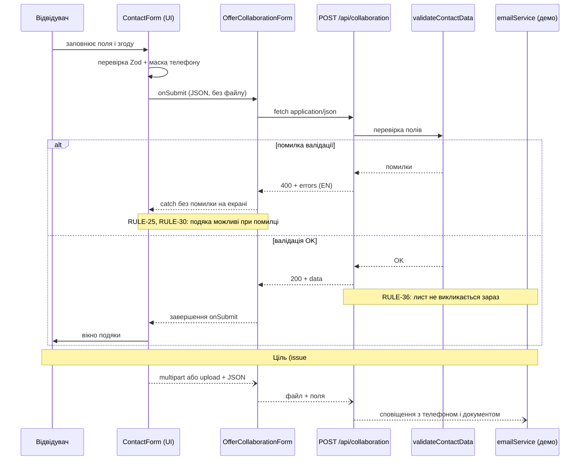

# Контактна форма, щоб фонд отримував повне звернення

Пов’язано з [issue #1](https://github.com/SerhiyAndryeyev/sdd-workshop-SerhiyAndryeyev/issues/1). Джерела: код гілки `day-2`, `docs/contact-form-rules.md`, критерії з розмови.

---

## 1. Короткий опис і вихідний запит

Форма на сторінках контактів і співпраці збирає звернення до фундації. Зараз телефон обов’язковий на UI (форма) і на API (перевірка). Поля для документа ще немає. Сповіщення (лист) у демо не відправляється. Після зміни відвідувач зможе додати PDF і фонд побачить телефон і вкладення в сповіщенні.

**Оригінал із issue #1 (дослівно):**

> We want to tighten up the contact form. Phone number should be mandatory.
> We should also let visitors attach a document (CV or portfolio) when they write
> to us. Notifications need to reflect the new field.

<!-- edited: робоче припущення PDF до 5 МБ поки немає відповіді на Q-01, Q-02 -->

---

## 2. Бізнес-контекст

| Поле | Зміст |
| --- | --- |
| **Ціль** | Відвідувач надсилає звернення з обов’язковим телефоном і за бажанням додає CV або портфоліо. Фонд отримує сповіщення з усіма полями. |
| **Метрика успіху** | Валідне звернення доходить до фонду без втрати телефону та даних про вкладення (якщо файл додали). |
| **Обмеження (NFR)** | Навчальний репозиторій: база MongoDB в пам’яті — дані заявок між перезапусками не зберігаються. Інтерфейс `uk` і `en` без змішування мов. Телефон і файл — персональні дані згідно з політикою конфіденційності. |

Коментар «Business context» у issue стосується сторінки «Про фонд», не цієї форми. Тут контекст узгоджений із **Original request** і `AGENTS.md`.

---

## 3. User stories

«Як відвідувач сайту, я хочу вказати обов’язковий номер телефону в формі звернення, щоб фонд міг мені відповісти без додаткових листів.»

«Як відвідувач сайту, я хочу додати документ (CV або портфоліо), щоб пояснити свою пропозицію співпраці.»

«Як співробітник фонду, я хочу отримати сповіщення з ім’ям, поштою, телефоном, текстом і даними про вкладення, щоб обробити звернення в одному місці.»

«Як відвідувач сайту, я хочу бачити помилки форми мовою сторінки (`/uk/...` або `/en/...`), щоб зрозуміти, що виправити.»

«Як відвідувач сайту, я хочу погодитися з політикою конфіденційності перед надсиланням, щоб знати, як обробляють мої дані.»

---

## 4. Діаграма послідовності

Потік **як зараз** (суцільні стрілки) і **ціль після issue** (пунктир у блоці `alt`), лише там, де код або issue дають підставу.

<!-- edited: цільовий крок upload/multipart не зафіксований у коді — Q-13 -->

---

## 5. Таблиця правил (RULE-ID, три стани)

Колонки **Є зараз** і **Має бути** з `docs/contact-form-rules.md`. Порожня клітинка «Має бути» означає, що цільова поведінка збігається з поточною або замовник її окремо не формулював.

| RULE-ID | Правило (коротко) | Є зараз | Має бути |
| --- | --- | --- | --- |
| RULE-01 | Ім’я обов’язкове, 2–50, trim на UI | Так | |
| RULE-02 | Ім’я на API 2–50, без trim | Так | |
| RULE-03 | Пошта обов’язкова на UI | Так | |
| RULE-04 | Пошта на API за regexp | Так | |
| RULE-05 | Повідомлення 10–1000, trim на UI | Так | |
| RULE-06 | Повідомлення 10–1000 на API | Так | |
| RULE-07 | maxLength 50 / 1000 у браузері | Так | |
| RULE-08 | Телефон обов’язковий на UI | Так | |
| RULE-09 | Сервер відхиляє порожній телефон | Так | |
| RULE-10 | Сервер: `+` і 11–16 цифр | Так | |
| RULE-11 | Маска: коди країн | Так | |
| RULE-12 | Маска: мін. довжина за країною | Так | |
| RULE-13 | Префікс `38` для номера з `0` | Так | |
| RULE-14 | Помилка маски блокує submit | Так | |
| RULE-15 | Нормалізація: `+` і цифри; порожній → `undefined` | Так | |
| RULE-16 | Поле документа (CV / портфоліо) | Ні | Відвідувач може додати документ |
| RULE-17 | Клієнт шле JSON без файлу | Так | |
| RULE-18 | API читає JSON | Так | |
| RULE-19 | Помилки форми з i18n (`contactForm.errors`) | Так | |
| RULE-20 | Мітка телефону з зірочкою | Так | |
| RULE-21 | Текст помилки API англійською | Так | |
| RULE-22 | 400 зі списком помилок | Так | |
| RULE-23 | 500 на `/api/collaboration` | Так | |
| RULE-24 | `/api/contact` без try/catch | Так | |
| RULE-25 | Помилка API не на екрані (console) | Так | |
| RULE-26 | Валідація `onChange` | Так | |
| RULE-27 | `disabled` під час submit | Так | |
| RULE-28 | Підказка max зникає через 3 с | Так | |
| RULE-29 | Вікно подяки після `onSubmit` | Так | |
| RULE-30 | Подяка можлива при помилці API | Так | |
| RULE-31 | GetNotesModal: та ж форма, без API | Так | |
| RULE-32 | Виклик лише `/api/collaboration` | Так | |
| RULE-33 | Згода з політикою на UI | Так | |
| RULE-34 | Посилання на політику в тексті згоди | Так | |
| RULE-35 | Сервер згоду не перевіряє | Так | |
| RULE-36 | Маршрути не викликають лист | Так. Лист не йде. | |
| RULE-37 | emailService — заглушка | Так | |
| RULE-38 | У листі телефон лише якщо є | Так | |
| RULE-39 | У листі немає поля документа | Ні | Сповіщення відображає нове поле (документ) |
| RULE-40 | HTML листа без екранування | Так | |
| RULE-41 | Лист англійською | Так | |
| RULE-42 | Успіх повертає PII у JSON | Так | |

Повні формулювання і рядки коду — у `docs/contact-form-rules.md`.

<!-- edited: RULE-36 у таблиці rules без колонки «Має бути»; AC-17 вимагає доставку сповіщення — рішення Q-21 -->

---

## 6. Критерії приймання (AC-NN)

Межі файлу в AC: **лише PDF, до 5 МБ** — робоче припущення воркшопу до відповіді **Q-01**, **Q-02**.

### AC-01 | RULE-08, RULE-09, RULE-20

- **Given** відвідувач відкрив форму на сторінці контактів або співпраці мовою з адреси
- **When** він натискає надіслати з порожнім полем телефону
- **Then** запит не відправляється і він бачить повідомлення про обов’язковий телефон

### AC-02 | RULE-08, RULE-14, RULE-10

- **Given** відвідувач заповнив інші обов’язкові поля
- **When** він вводить телефон у невалідному форматі або маска показує помилку
- **Then** запит не відправляється і він бачить повідомлення про невалідний формат телефону

### AC-03 | RULE-09, RULE-21

- **Given** клієнт надсилає POST без поля `phoneNumber` або з порожнім рядком
- **When** API перевіряє тіло запиту
- **Then** API повертає код 400 і текст `Phone number is required.`

### AC-04 | RULE-09, RULE-10, RULE-21

- **Given** клієнт надсилає POST з телефоном без префікса `+`, з літерами або довжиною поза 11–16 символами (з `+`)
- **When** API перевіряє тіло запиту
- **Then** API повертає код 400 і текст про невалідний номер телефону

### AC-05 | RULE-10, RULE-15

- **Given** клієнт надсилає валідні ім’я, пошту, повідомлення і телефон `+` з 11–16 цифрами
- **When** API перевіряє тіло запиту
- **Then** перевірка телефону не додає помилок до відповіді

### AC-06 | RULE-16

- **Given** відвідувач відкрив форму
- **When** він переглядає поля вводу
- **Then** він бачить можливість додати файл з підказкою про CV або портфоліо

### AC-07 | RULE-16

- **Given** відвідувач заповнив обов’язкові поля і додав файл PDF розміром не більше 5 МБ
- **When** він надсилає форму
- **Then** звернення приймається з кодом успіху

### AC-08 | RULE-16

- **Given** відвідувач додав файл розміром більше 5 МБ
- **When** він намагається надіслати форму
- **Then** форма не відправляється і він бачить повідомлення про перевищення розміру файлу

### AC-09 | RULE-16

- **Given** відвідувач додав файл з MIME-типом, відмінним від PDF
- **When** він намагається надіслати форму
- **Then** форма не відправляється і він бачить повідомлення про недозволений тип файлу

### AC-10 | RULE-16

- **Given** відвідувач заповнив усі обов’язкові поля і не обрав файл
- **When** він надсилає форму
- **Then** звернення приймається з кодом успіху

### AC-11 | RULE-33

- **Given** прапорець згоди з політикою вимкнений
- **When** відвідувач натискає надіслати
- **Then** запит не відправляється і він бачить повідомлення про обов’язкову згоду

### AC-12 | RULE-34

- **Given** відвідувач на формі
- **When** він переходить за посиланням політики конфіденційності в тексті згоди
- **Then** він потрапляє на сторінку політики конфіденційності своєї мови

### AC-13 | RULE-27

- **Given** відвідувач надіслав форму і запит ще виконується
- **When** він дивиться на кнопку надіслати
- **Then** кнопка неактивна до завершення запиту

### AC-14 | RULE-25, RULE-30

- **Given** API повернув відповідь з кодом 400 або 500
- **When** клієнт обробляє відповідь
- **Then** відвідувач бачить повідомлення про помилку, а не вікно подяки

### AC-15 | RULE-38, RULE-39

- **Given** звернення прийнято з валідним телефоном без файлу
- **When** фонд отримує сповіщення про нове звернення
- **Then** у сповіщенні є ім’я, пошта, телефон і текст повідомлення

### AC-16 | RULE-39

- **Given** звернення прийнято з валідним PDF-вкладенням
- **When** фонд отримує сповіщення
- **Then** у сповіщенні є назва файлу або посилання для отримання вкладення

### AC-17 | RULE-36, RULE-37

- **Given** API успішно прийняв валідні дані форми
- **When** обробка звернення завершується
- **Then** фонд отримує сповіщення (лист або еквівалент у демо), а не лише порожню відповідь успіху без доставки

### AC-18 | RULE-19

- **Given** відвідувач відкрив форму за адресою `/uk/...`
- **When** спрацьовує помилка обов’язкового або невалідного телефону
- **Then** текст помилки відображається українською з розділу `contactForm.errors`

### AC-19 | RULE-19

- **Given** відвідувач відкрив форму за адресою `/en/...`
- **When** спрацьовує помилка обов’язкового або невалідного телефону
- **Then** текст помилки відображається англійською з розділу `contactForm.errors`

### AC-20 | RULE-19

- **Given** відвідувач відкрив форму за адресою `/uk/...`
- **When** спрацьовує помилка розміру або типу файлу
- **Then** текст помилки відображається українською з розділу `contactForm.errors`

### AC-21 | RULE-19

- **Given** відвідувач відкрив форму за адресою `/en/...`
- **When** спрацьовує помилка розміру або типу файлу
- **Then** текст помилки відображається англійською з розділу `contactForm.errors`

### AC-22 | RULE-33, RULE-35

- **Given** відвідувач надіслав форму зі ввімкненою згодою
- **When** фонд обробляє заявку у демо-середовищі
- **Then** телефон і файл (якщо є) обробляються лише для цілей відповіді на звернення згідно з політикою конфіденційності

### AC-23 | NFR (демо)

- **Given** звернення з PDF успішно прийнято в демо-режимі
- **When** застосунок зупинено і запущено знову
- **Then** раніше завантажений файл недоступний за тим самим посиланням (дані демо не переживають перезапуск)

---

## 7. Таблиця ключових файлів

| Файл | Навіщо він фічі |
| --- | --- |
| `app/shared/components/forms/contact-form/ContactForm.tsx` | UI форми, Zod, маска телефону, згода, подяка |
| `app/shared/components/forms/offer-collaboration-form/OfferCollaborationForm.tsx` | Submit на `/api/collaboration`, стан `isSubmitting` |
| `app/lib/utils/validateContactData.ts` | Серверна перевірка полів контакту / співпраці |
| `app/constants/validation.ts` | Довжини полів, regexp пошти й телефону |
| `app/constants/errors.ts` | Англомовні тексти помилок API |
| `app/lib/utils/normalizePhoneNumberFromMask.ts` | Формат `+` і цифри перед відправкою |
| `app/shared/hooks/use-handle-phone-input/useHandlePhoneInput.ts` | Маска і коди країн телефону |
| `app/api/collaboration/route.ts` | POST співпраці, валідація, відповідь |
| `app/api/contact/route.ts` | POST контакту (паралельний маршрут, зараз не викликається з UI) |
| `app/services/email/emailService.ts` | Заглушка відправки листа |
| `app/services/email/emails/emails.ts` | HTML-шаблони сповіщень |
| `app/services/upload/upload.ts` | Демо-сховище файлів (може стосуватися вкладень) |
| `i18n/messages/uk.json`, `i18n/messages/en.json` | Тексти форми й помилок UI |
| `app/shared/components/get-notes-modal/GetNotesModal.tsx` | Та сама `ContactForm` без API (творчість) |

---

## 8. Відкриті питання (Q-NN)

Повний контекст (блокування, роль, дата, AC/RULE) — у [коментарі issue #1](https://github.com/SerhiyAndryeyev/sdd-workshop-SerhiyAndryeyev/issues/1#issuecomment-7131862097).

| ID | Питання |
| --- | --- |
| Q-01 | Який максимальний розмір вкладення (5 МБ з інструкції дня 2 — затверджуєте)? |
| Q-02 | Лише PDF чи також DOCX / інші типи? |
| Q-03 | Скільки файлів за одне звернення: один CV/портфоліо чи кілька? |
| Q-04 | Телефон: маска з кодами країн чи сервер 11–16 з `+` — яке правило остаточне? |
| Q-05 | Чи сервер зрізає пробіли в імені, як UI? |
| Q-06 | Сповіщення фонду: лише англійською, мовою сторінки чи завжди українською? |
| Q-07 | Помилки API 400: залишити англійською чи повертати uk/en? |
| Q-08 | Чи потрібен лист-підтвердження відвідувачу і в якій мові? |
| Q-09 | При 400/500 показувати помилку на формі без вікна подяки? |
| Q-10 | Якщо файл не завантажився: відмова, прийняти без файлу чи повтор? |
| Q-11 | Якщо лист не відправився: помилка користувачу чи успіх з внутрішнім алертом? |
| Q-12 | Чи уніфікувати `/api/contact` і `/api/collaboration`? |
| Q-13 | PDF: вкладення листа, blob з посиланням чи обидва? |
| Q-14 | У демо: mock-blob + заглушка листа достатньо чи повна імітація збереження? |
| Q-15 | Blob: папка, доступ до URL, термін дії посилання? |
| Q-16 | Скільки зберігають телефон, текст і файл після відповіді? |
| Q-17 | Чи сервер має відхиляти запит без згоди з політикою? |
| Q-18 | Чи прибрати PII з JSON-відповіді успіху (RULE-42)? |
| Q-19 | `GetNotesModal`: та ж форма з обов’язковим телефоном без API чи окрема поведінка? |
| Q-20 | Куди йдуть звернення: лише cooperation, contact чи один канал? |
| Q-21 | Реальна адреса і канал сповіщення в scope issue чи лише шаблон у демо? |
| Q-22 | Чи оновити RULE-15 після обов’язкового телефону (без `undefined`)? |
| Q-23 | «Tighten up the contact form»: чи достатньо телефон + файл + сповіщення в scope? |